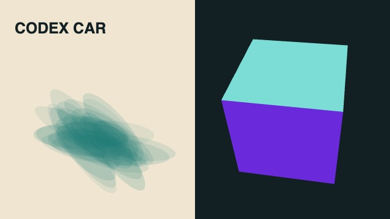

# Validation results

Executed locally on 18 October 2026, on Apple silicon macOS, with Node v22.20.0, the locked npm dependencies, Playwright Chromium Headless Shell 153.0.8010.12, ffmpeg and a Python 3.12 environment.

| Check | Result |
| --- | --- |
| `npm run check` | All 51 style prompts match the reviewed upstream SHA-256 hashes; inventory, original copyright, Codex files and package names pass. |
| `npm test` | Twenty tests pass, including strict source/movie/audio/format/inventory publication gates and setup/installer integration: discovery outside the repo; refusal to overwrite user folders; invalid command/tier handling; standalone skill cloning and preservation of local edits; idempotent symlink installation and conflict refusal. Temporary paths contain spaces. |
| Skill Creator `quick_validate.py` | Skill frontmatter and naming pass. This is structural validation, not a film quality evaluation. |
| Shell syntax and `git diff --check` | Pass for the new setup entry points; no whitespace errors in the patch. |
| Core dependency setup | `sh tools/setup.sh deps` completed; npm lockfile install, headless Chromium and core Python packages installed. |
| Canvas + Three.js fixture | Stills at 0 s and 2 s rendered; the 2 s still was visually inspected. Canvas drawing, library imports, Three.js/WebGL and the shared headless browser work together. |
| Text reading-time check | Pass: `GPTCAR`, 6 non-space characters, required 1.90 s, visible for 4.00 s. |
| Event export | One event, duration 4 s, exported correctly. |
| Frame-by-frame video | H.264, 640×360, 24 fps, 96 frames, 4.000 s. |
| Python audio and mux | Core `sfx` import and NumPy/soundfile audio creation succeed; ffmpeg produces H.264 + AAC. Final measured loudness −13.9 LUFS; reported peak −7.8 dBFS. |
| Blank-frame scan | No black intervals reported by `blackdetect` with duration 0.1 s and pixel threshold 0.05. |



This image is a technical test fixture, not a finished watercolor film or a demonstration of style parity.

## Reproduce the render checks

After `sh tools/setup.sh deps`, from the library root:

```sh
node core/render/still.mjs tests/fixtures/render 0 2 --size 640x360 --out /tmp/gptcar-stills
node core/render/readcheck.mjs tests/fixtures/render --size 640x360
node core/render/events.mjs tests/fixtures/render --size 640x360 --out /tmp/gptcar-events.json
node core/render/video.mjs tests/fixtures/render --size 640x360 --fps 24 --workers 1 --out /tmp/gptcar-picture.mp4
```

Use an unused output path. These commands exercise the actual toolkit and the committed deterministic test page. The audio check used a four-second NumPy-generated two-tone WAV, followed by `core/render/mux.sh` and an ffmpeg loudness/black-frame scan. It did not exercise narration.

## Limits

- The original technical smoke test above remains a renderer fixture. The rejected initial20-second studies remain historical in [comparison/REPORT.md](../comparison/REPORT.md). Full-length replacements, matched-scene reviews, fresh audio and per-film technical records are documented in [comparison/REPLICATION_REPORT.md](../comparison/REPLICATION_REPORT.md). This is a source-informed qualitative comparison, not a controlled model benchmark.
- The initial smoke fixture did not exercise optional audio tiers. The subsequent reconstruction run installed and exercised Kokoro, edge-tts, Whisper, sampled instruments, physical plucks and project-specific data/asset importers; Game Show freshly uses the installed macOS system voices. Per-film narration reports disclose ASR ambiguity and are not claims of human auditory audition. These tools/assets remain separate setup prerequisites on a new machine.
- Nine inherited demos do not have `demo/build.sh`: paper-popup, halftone-dossier, paper-lantern, brick-toy, game-show, hd-2d, pictogram-motion, watercolor and cel-anime-80s. Their sources use other entry points documented in the demos. The adapter preserves them rather than claiming every inherited demo is a fresh one-command build. New user films should include their own build script.
- Platform testing was local macOS only. CI checks the adapter on Linux; rendering on Linux/WSL still needs browser/GPU and system dependencies.
- The original gallery and demo videos are upstream-authored material. Successful technical checks do not turn them into Codex output.


## Production recipe and relocation checks

The skill entry point routes new films through the shared production findings
and one of 51 specific asset/material/motion/review profiles. `python3
tools/style_recipe.py --validate` checks the complete inventory and that every
recorded prompt, treatment, scene, narration, score, credits and review path exists.
The example helper defaults to inspection; render, fetch and compare are explicit.
Tests cover unknown style/path rejection, portable workspace resolution (including
spaces and an explicit override), and SHA-verified asset installation that keeps
an existing file intact on a bad response. `GPTCAR_WORK_DIR` defaults to
`work/replication/` under the actual checkout, independent of its parent folder.

After moving the checkout, setup discovery and source/dependency checks passed
for Watercolor and LiDAR; three real Watercolor frames were rendered at the new
location. The strict full-gallery build verifies all 51 original accepted
source/movie bindings after the guidance and tooling updates. These checks do
not constitute a new 51-film generation run or an artistic parity certification.
